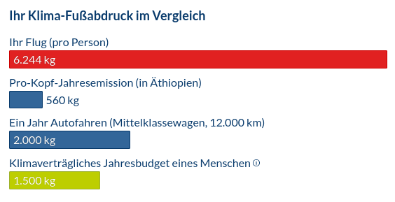

Viele Jahre lang hatte mein persönliches CO2-Budget einen zentralen Platz in meinen Gedanken. Inzwischen glaube ich, dass es uns eher begrenzt, als dass es uns hilft. In diesem Post möchte ich erklären, wie ich zu dieser Sicht gekommen bin und wie wir erfolgreicher über Klimaschutz nachdenken können.

Die Idee des CO2-Budgets ist simpel und gerade deswegen so überzeugend: Man nehme die jährliche Menge CO2, welche die Erdatmosphäre noch aufnehmen kann, ohne dass wir ein bestimmtes Klimaziel verfehlen, und teile sie durch die Anzahl der Menschen auf diesem Planeten.

Wenn man diese Rechnung mit Daten befüllt, wird schnell klar, dass „unser“ Lebensstil (deiner, meiner, der fast aller Menschen, die wir kennen) nicht mit dem Klimaziel vereinbar ist. [Der durchschnittliche CO2-Ausstoß in Deutschland liegt bei 7,9 Tonnen pro Person und Jahr][Weltbank]. Die Klimaschutzorganisation Atmosfair rechnet hingegen vor, [dass jedem Menschen auf der Erde nur 1,5 Tonnen CO2 pro Jahr zustehen][Atmosfair CO2 Budget]. Wir liegen also beim Fünffachen.

Ich halte diese Überlegung für nachvollziehbar und hilfreich. Sie macht greifbar, dass der Klimawandel etwas mit unserem eigenen Leben zu tun hat. Ich kann mir gut vorstellen, dass sie viele Menschen davon überzeugt hat, selbst ein wichtiger Baustein der Lösung zu sein. Weiter reicht das Argument aus meiner Sicht aber nicht: Es zeigt gut, *dass* wir handeln sollten. Als Maßstab dafür, *wie* wir handeln sollten, taugt es wenig.

# Das Problem mit dem CO2-Budget

Eine naheliegende Folgerung aus dem CO2-Budget ist, das eigene Budget nicht zu überziehen: aus moralischen Gründen den anderen Menschen auf der Erde gegenüber, um ein Vorbild für andere zu sein, und um etwas gegen den Klimawandel zu tun.

Das eigene Budget einzuhalten, ist aber praktisch schwierig. Zum einen ist es in einem Land wie Deutschland überaus schwierig, unter 1,5 Tonnen pro Jahr zu bleiben. Zum anderen kann es zu Spannungen mit Menschen im eigenen Umfeld führen, die ihr Budget nicht einhalten.

Das größte Problem sehe ich aber darin, dass uns das Budget künstlich begrenzt. Es lenkt unseren Blick allein auf den eigenen Ausstoß, und dort ist die mögliche Wirkung gedeckelt. Selbst wenn eine Person viel auf sich nimmt und ihr Budget einhält, spart sie gegenüber dem deutschen Durchschnitt nur 6,4 Tonnen pro Jahr ein (7,9 minus 1,5 Tonnen). Das ist kaum mehr als der Ausstoß pro Person eines einzigen Flugs von Frankfurt nach Bangkok: rund 6,2 Tonnen, berechnet mit dem [Atmosfair-Rechner][Atmosfair Rechner] am 19.02.2023. Ein ganzes Jahr Verzicht wiegt also ungefähr so viel wie ein Flug.

# Dabei können wir so viel mehr erreichen

Diese Grenze gilt allerdings nur, solange wir ausschließlich auf unseren eigenen Ausstoß schauen. Sobald wir fragen, wie viel CO2 wir insgesamt vermeiden können, egal wessen, öffnen sich Wege mit deutlich größerer Wirkung.

Ein Weg ist persönliche politische Arbeit: entweder [selbst als Entscheidungsträgerin oder Entscheidungsträger][Politik als Beruf] oder indem wir [Einfluss auf Entscheidungsträgerinnen und Entscheidungsträger nehmen][Klimabewegung]. So können wir darauf hinwirken, dass wir als Gemeinschaft erheblich weniger CO2 ausstoßen. Wenn du die Einsparung, die ihr gemeinsam erreicht, auf dich und deine Mitstreiterinnen und Mitstreiter aufteilst, kommst du schnell auf erheblich mehr als 6,4 Tonnen pro Person.

Ein anderer Weg besteht darin, andere Menschen dabei zu unterstützen, weniger CO2 auszustoßen, zum Beispiel mit Spenden. Das kann direkt wirken, indem wir sie mit effizienteren Technologien versorgen ([beispielsweise mit effizienteren Öfen zum Kochen und Heizen][Effiziente Oefen]). Oder indirekt, indem wir Organisationen befähigen, in unserem Auftrag Einfluss auf CO2-relevante Entscheidungen zu nehmen ([etwa durch CO2-wirksamen Lobbyismus][Clean Air Task Force]). Auch hier halte ich es für plausibel, dass du damit erheblich mehr als deinen persönlichen CO2-Ausstoß einsparen kannst.

Ein dritter Weg besteht darin, [unser zukünftiges Selbst mit effizienteren Technologien zu versorgen][Future Cleantech Architects], sprich: in Forschung zu investieren. Wenn du oder jemand, den du dazu befähigst, herausfindet, wie wir Energie und Werkstoffe mit weniger CO2-Ausstoß herstellen können, dann… du weißt schon.

# Fazit

Die Menschheit überzieht ihr klimaverträgliches CO2-Budget seit Jahrzehnten erheblich. Ich halte es für ein moralisch folgerichtiges Ziel, persönlich dagegen anzugehen. Und ich bin überzeugt, dass wir alle dabei erheblich mehr erreichen können, als nur unseren eigenen CO2-Ausstoß zu senken. Lasst uns unsere persönlichen CO2-Budgets als Maßstab vergessen und loslegen!

[Weltbank]: https://datacommons.org/ranking/Amount_Emissions_CarbonDioxide_PerCapita/Country/europe?h=country%2FDEU&unit=t&hl=de
[Atmosfair CO2 Budget]: https://www.atmosfair.de/de/gruenreisen/persoenliches_klimabudget/
[Effiziente Oefen]: https://www.atmosfair.de/de/klimaschutzprojekte/energieeffizienz/
[Clean Air Task Force]: https://effektiv-spenden.org/clean-air-task-force/
[Future Cleantech Architects]: https://effektiv-spenden.org/future-cleantech-architects/
[Atmosfair Rechner]: https://www.atmosfair.de/de/kompensieren/flug/
[Politik als Beruf]: https://de.wikipedia.org/wiki/Politik_als_Beruf
[Klimabewegung]: https://www.bpb.de/themen/klimawandel/dossier-klimawandel/546184/klimabewegung/
